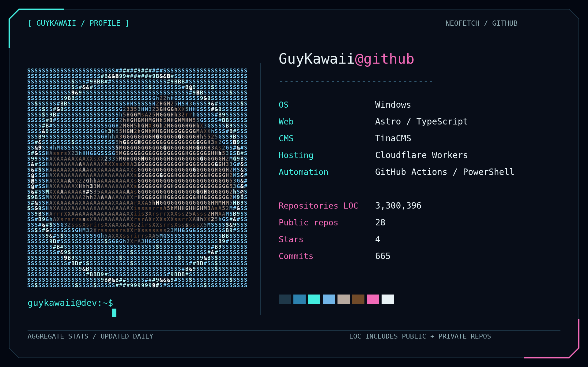

  

The profile shows one combined total of lines of code across all public and private
repositories owned by the authenticated user, including forks and archived repositories. It counts
the current default branch, excluding blank lines, comments, and common dependency
and build directories. This is repository code, not personal authorship or lifetime
lines added. Language statistics still cover public repositories.

The scheduled workflow installs `cloc`. For local runs, install `cloc` on your PATH
and the Python dependencies from `requirements.txt`, then run `python main.py`.
Store `GH_TOKEN` as a repository Actions secret with access to **all owned repositories**,
including private ones. Use a fine-grained token owned by your account with
All repositories selected and read-only Contents, Issues, and Pull requests
permissions (Metadata is included automatically). No account permissions are needed.
You can select No expiration. The workflow uses the separate built-in `GITHUB_TOKEN`
to push the generated image, so `GH_TOKEN` needs no write permissions. A restricted
token only counts repositories it can access. Never put a token in the README or config.

Only the combined line count is rendered; public/private breakdowns, private
repository names, and private source are not published. Downloaded snapshots are temporary. A counting failure stops the
update rather than publishing a partial total.

The animated card converts your GitHub avatar into multicolor ASCII using an
HTML canvas, with a gentle color shimmer and blinking terminal cursor. Repositories LOC
is the combined total; the smaller public repos, stars, and commits rows cover
public activity. After installing dependencies locally, run `python -m playwright install chromium`
to install the canvas renderer. Open `assets/ascii-portrait.html` in a browser to
preview the effect with a local image. No ASCII Magic account or API is required;
this is our own canvas implementation inspired by its color style.
A static PNG is also generated at `out/fetch.png`.
