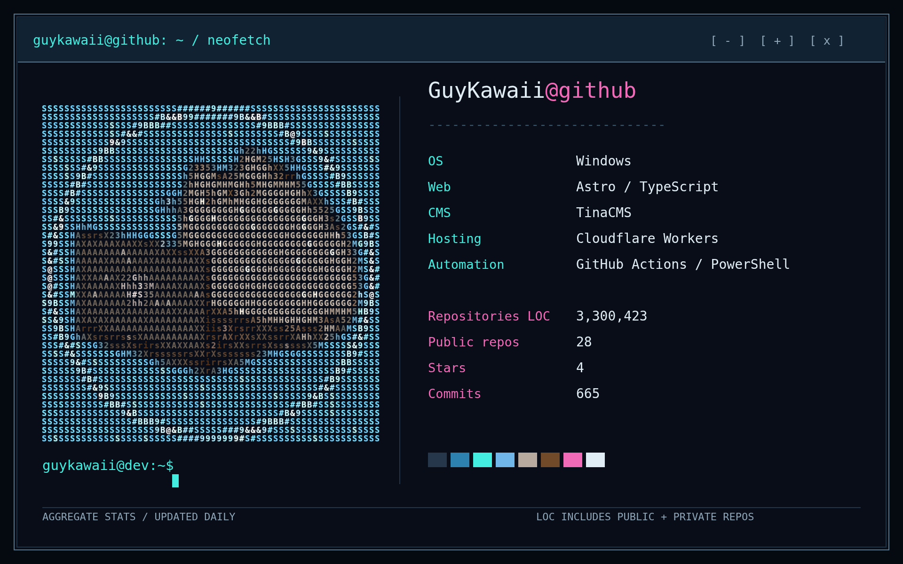

  

The profile includes public, private, and total lines of code across all repositories
owned by the authenticated user, including forks and archived repositories. It counts
the current default branch, excluding blank lines, comments, and common dependency
and build directories. This is repository code, not personal authorship or lifetime
lines added. Existing byte and language statistics still cover public repositories.

The scheduled workflow installs `cloc`. For local runs, install `cloc` on your PATH
and the Python dependencies from `requirements.txt`, then run `python main.py`.
Store `GH_TOKEN` as a repository Actions secret with access to **all owned repositories**,
including private ones. A classic token with `repo` scope supports this existing
workflow (which also pushes the generated image). A restricted token only counts
repositories it can access. Never put a token in the README or config.

Only aggregate private line counts are rendered; private repository names and source
are not published. Downloaded snapshots are temporary. A counting failure stops the
update rather than publishing a partial total.
